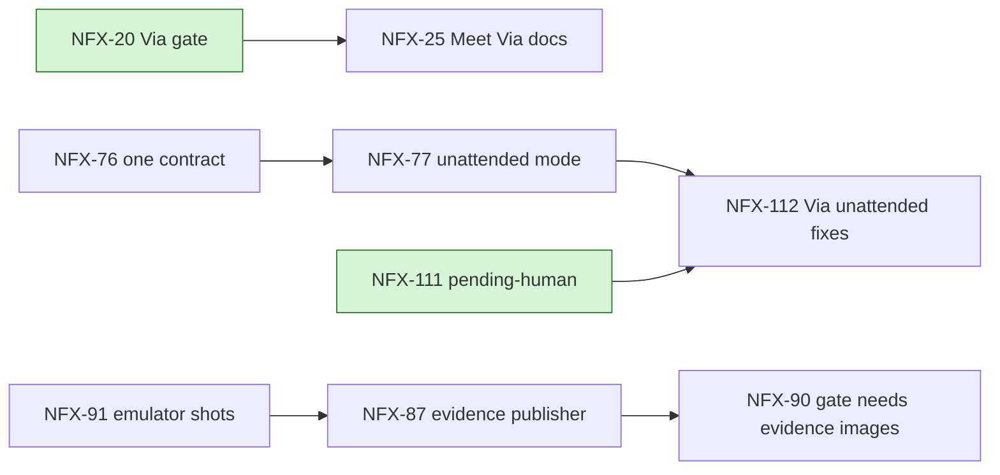

# NousFX roadmap

- Date: 2026-11-13 (NFX-137, 109 and 115 merged; NFX-113 in progress)
- HEAD: `c21f86b` on `main` (NFX-113 is on branch `cesar/NFX-113`, 0 other open PRs)
- Source: Jira NFX, `statusCategory != Done` (25 tickets) and Done in the last 14 days (117 tickets); `.claude/handoff.md`; `CHANGELOG.md`
- Since last run (2026-11-06): the open count went from 32 to 25. v1.1 shipped (2026-11-09). v1.2 is down to NFX-113 and NFX-125. Unattended mode moved to v1.4 on 2026-11-09.

## Answer

- v1.2 "Hardened harness": 2 tickets left. NFX-113 (drift cleanup, in progress, this PR) and NFX-125 (live checks on your devices).
- After the NFX-113 PR merges, only NFX-125 and your manual checks stand between you and the `v1.2.0` tag.
- Next release is v1.3 "Via 2": 4 tickets. NFX-20 blocks NFX-25. Start with NFX-20 (it needs a Fable plan: `fable-review`).

## Snapshot

| Group | Open | Top priority | Status |
| --- | --- | --- | --- |
| v1.2 Hardened harness | 2 | Medium | NFX-113 in progress, NFX-125 `ready-for-human` |
| v1.3 Via 2 | 4 | Medium | NFX-20, 25, 111, 141 |
| v1.4 Unattended mode and PR evidence | 6 | High (NFX-87) | NFX-76, 77, 87, 90, 91, 112 |
| Later | 8 | Medium | NFX-15, 21, 22, 43, 45, 50, 60, 67 |
| Epics (milestones) | 5 | Medium | NFX-2, 3, 4, 34, 84 |
| **Total** | **25** | | 5 epics + 20 tickets |

```
v1.1  [##########] shipped 2026-11-09
v1.2  [#########-] only NFX-113 (code) and NFX-125 (devices) left
v1.3  [####------] NFX-81, 82, 124 done; 4 open
v1.4  [----------] not started
```

## Organization

```
Jira NFX
├── Epics: M1 Via core (2), M2 gate and exports (3), M3 share-ready (4), M4 portable harness (34), M5 unattended-ready (84)
└── Releases (fixVersion)
    ├── v1.2  113, 125
    ├── v1.3  20, 25, 111, 141
    ├── v1.4  76, 77, 87, 90, 91, 112
    └── Later 15, 21, 22, 43, 45, 50, 60, 67
```

## Dependency flow



```
NFX-20 -> NFX-25
NFX-76 -> NFX-77 -> NFX-112 <- NFX-111
NFX-91 -> NFX-87 -> NFX-90
```

## Per release

### v1.2 (NFX-113 and NFX-125)

| Key | Title | Priority | Status | Blocked by |
| --- | --- | --- | --- | --- |
| NFX-113 | Drift cleanup: delete `claude/agents`, rules under budget, refresh roadmap | Medium | In progress | none |
| NFX-125 | Live checks still unproven: agy plugin and gate, Windows sync | Medium | To Do, `ready-for-human`, env-device | none |

### v1.3

| Key | Title | Priority | Status | Blocked by |
| --- | --- | --- | --- | --- |
| NFX-20 | Via gate: block UI PRs until `/via check` passes | Medium | To Do, `fable-review` | none (NFX-5 and 17 Done) |
| NFX-25 | Meet Via docs, CONTRIBUTING and a fresh-user test | Medium | To Do | NFX-20 |
| NFX-111 | Via check: a pending-human state that doesn't count as open | Medium | To Do | none |
| NFX-141 | ticket-check: can S tickets with explicit file paths skip it? | Medium | To Do, `needs-triage` | none |

### v1.4

| Key | Title | Priority | Status | Blocked by |
| --- | --- | --- | --- | --- |
| NFX-76 | One contract from any spec source | Medium | `ready-for-human`, `fable-review`, size L | none |
| NFX-77 | Unattended mode: one definition, a draft PR without asking | Medium | `needs-triage`, size L | NFX-76 |
| NFX-87 | PR evidence publisher | High | To Do | NFX-91 |
| NFX-90 | Gate requires evidence images on UI PRs | Medium | To Do | NFX-87 |
| NFX-91 | Emulator shots: demo mode and crop | Medium | To Do | none (NFX-10 Done) |
| NFX-112 | Via unattended: apply in-scope fix-now findings | Low | `ready-for-human` | NFX-77, NFX-111 |

### Later

NFX-15 learning loop, 21 Obsidian run note, 22 `/via export figma` (device), 43 agy and OpenCode fallback, 45 lean profile, 50 OpenCode spike (human), 60 harness evals, 67 second-opinion role (`needs-triage`).

## Inconsistencies

| Kind | Evidence | Suggested fix |
| --- | --- | --- |
| Fact: stale doc | This file said `HEAD 686c905` and dated 2026-11-06. | Refreshed here. |
| Fact: stale ticket text | NFX-113 says "land after NFX-77", but NFX-77 moved to v1.4 and has no link to NFX-113. | Ignore; edit the ticket if you want. |
| Fact: CHANGELOG vs Jira (fixed in the NFX-113 PR) | `CHANGELOG.md` kept every unreleased entry under `1.3.0`. Jira puts NFX-81 and 82 in v1.3; the others are v1.2. | Done: the v1.2 items moved under `1.2.0`; NFX-81 and 82 stay under `1.3.0`. |
| Fact: cross-release block | NFX-112 (v1.4) is blocked by NFX-111 (v1.3). | Fine: v1.3 lands first. |
| Fact: missing fixVersion | NFX-142 and NFX-143 are Done with no fixVersion. | Set v1.2 in Jira (your call). |
| Check: epic state | NFX-2, 3 and 4 are open although v1.0 and v1.1 shipped. | Confirm which epics still have open children, then close the finished ones. |
| Check: unconfirmed live work | NFX-110, NFX-115 and the pinned checkout SHA are merged but unverified on real GitHub or Windows (handoff). | NFX-125 and the manual steps cover them. |
| Order violations | Done tickets with an open blocker: none found. Epics with every child Done: not computed (no child list queried). | |

## Suggested order

| Ticket | Unblocks | Value | Risk | Priority | Effort | Total |
| --- | --- | --- | --- | --- | --- | --- |
| NFX-113 | 1 (release) | 2 | 1 | 2 | M | 6 |
| NFX-125 | 1 (release) | 2 | 3 | 2 | S | 8 (needs you) |
| NFX-20 | 2 | 3 | 1 | 2 | M | 8 |
| NFX-111 | 1 | 2 | 0 | 2 | S | 5 |
| NFX-25 | 0 | 2 | 0 | 2 | M | 4 |
| NFX-141 | 0 | 1 | 0 | 2 | S | 3 |

1. NFX-113: last v1.2 code ticket; its PR is open for you to merge.
2. NFX-125: needs your devices. It gates the `v1.2.0` tag.
3. NFX-20: starts v1.3 and unblocks NFX-25; it carries `fable-review`, so ask before using `architect`.
4. NFX-111: small and unblocks NFX-112.
5. NFX-25, then NFX-141 (needs triage first).

**Defer:** all of v1.4 (starts after v1.3), and every "Later" ticket. NFX-87 is High, but its blocker NFX-91 needs an emulator.

## Needs you

- Merge the NFX-113 PR, then tag `v1.2.0` (follow `docs/RUNBOOK.md`).
- NFX-125 on your devices (agy plugin and gate, Windows sync).
- Manual ACs: NFX-110 (throwaway PR with and without `review-skip`), NFX-115 on real Windows.
- Run `python3 -B scripts/nousfx_sync.py --tools claude` to install the drift hook.
- Decide whether to set the missing fixVersion on NFX-142 and 143.
