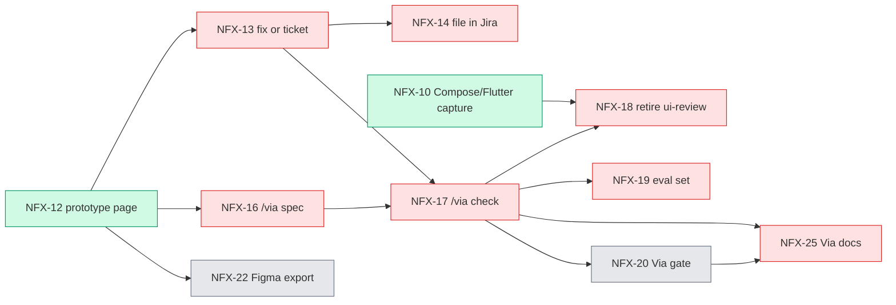

# NousFX roadmap

- Date: 2026-11-06
- HEAD: `716edaa` on `main` (clean tree, 0 open PRs)
- Source: Jira NFX, `statusCategory != Done` (32 tickets) and Done in the last 14 days (36 tickets); `.claude/handoff.md`; `CHANGELOG.md`; `docs/RUNBOOK.md`
- Since last run: first run, no earlier snapshot

> Updated later on 2026-11-06: inconsistencies #3 to #6 are fixed in Jira, and #2 is fixed in the handoff file. NFX-68 is under NFX-34, NFX-31/32/51 are under NFX-2, `ready-for-agent` is dropped on NFX-1 and NFX-33, and the follow-ups are filed as NFX-69, 70 and 71 (under NFX-34, after-v1). Open total is now 35. #1 (stale NFX-20 → NFX-24 link) was removed by Cesar in Jira. The tables below are the snapshot before these changes (32 open, 12 after-v1); NFX-69, 70 and 71 are after-v1 and not listed in them.

## Answer

- v1.0: 1 ticket left. NFX-53 (live checks on Mac and Windows). It is yours.
- v1.1: 12 tickets. Mostly Via. Critical path: NFX-12 → 13 / 16 → 17.
- after-v1: 12 tickets. All parked.
- No version or label: 7 (4 epics, 2 specs, and NFX-25).

## Snapshot

| Group | Open | v1.0 | v1.1 | after-v1 | No label | Done (14 d) |
|---|---|---|---|---|---|---|
| M1 Via core (NFX-2) | 11 | 0 | 9 | 2 (11, 15) | 0 | 5 |
| M2 Via gate and exports (NFX-3) | 3 | 0 | 0 | 3 (20, 21, 22) | 0 | 0 |
| M3 Share-ready (NFX-4) | 1 | 0 | 0 | 0 | 1 (25) | 3 |
| M4 Portable harness (NFX-34) | 8 | 1 (53) | 0 | 7 | 0 | 22 |
| Loose (31, 32, 51) | 3 | 0 | 3 | 0 | 0 | 6 |
| Epics and specs (1, 2, 3, 4, 33, 34) | 6 | 0 | 0 | 0 | 6 | 0 |
| **Total** | **32** | **1** | **12** | **12** | **7** | **36** |

Check: 32 = 4 epics + 2 specs + 23 children (11 + 3 + 1 + 8) + 3 loose.

```
M4 harness  [██████████████████████░░░░░░░░] 22 done / 8 open
M1 Via core [██████████░░░░░░░░░░░░░░░░░░░░]  5 done / 11 open
M3 share    [██████████████████████░░░░░░░░]  3 done / 1 open
M2 gate     [░░░░░░░░░░░░░░░░░░░░░░░░░░░░░░]  0 done / 3 open
```

## Organization

```
NousFX (Jira NFX)
├─ NFX-1  Spec: Via
├─ NFX-33 Spec: Portable harness
├─ M1 Via core (NFX-2)           11 open
├─ M2 Gate and exports (NFX-3)    3 open
├─ M3 Share-ready (NFX-4)         1 open
├─ M4 Portable harness (NFX-34)   8 open
└─ Loose: NFX-31, 32, 51          3 open
```

## Dependency flow



```
NFX-12 ─┬─> NFX-13 ─┬─> NFX-14
        │           └─> NFX-17 ─┬─> NFX-18 (also needs NFX-10)
        ├─> NFX-16 ───> NFX-17  ├─> NFX-19
        └─> NFX-22 (after-v1)   ├─> NFX-20 (after-v1) ─> NFX-25
                                └─> NFX-25
Startable now: NFX-10, 12, 31, 32, 51, 59 (v1.1) and NFX-53 (v1.0)
```

## Tickets by group

### M1 Via core (NFX-2)

| Key | Title | Priority | Version | Blocked by (open) |
|---|---|---|---|---|
| NFX-10 | Compose and Flutter capture | Medium | v1.1 | none |
| NFX-11 | SwiftUI capture | Medium | after-v1 | none |
| NFX-12 | Before/after prototype page | Medium | v1.1 | none |
| NFX-13 | Fix-now or ticket routes | Medium | v1.1 | 12 |
| NFX-14 | File findings as Jira tickets | Medium | v1.1 | 13 |
| NFX-15 | Learning loop | Medium | after-v1 | none |
| NFX-16 | /via spec | Medium | v1.1 | 12 |
| NFX-17 | /via check | Medium | v1.1 | 13, 16 |
| NFX-18 | Retire ui-review | Medium | v1.1 | 10, 17 |
| NFX-19 | Via eval set | Medium | v1.1 | 17 |
| NFX-59 | Via works in agy | Medium | v1.1 | none |

### M2 Via gate and exports (NFX-3)

| Key | Title | Priority | Version | Blocked by (open) |
|---|---|---|---|---|
| NFX-20 | Via gate (`fable-review`) | Medium | after-v1 | 17 |
| NFX-21 | Obsidian run note | Medium | after-v1 | none |
| NFX-22 | /via export figma (`ready-for-human`) | Medium | after-v1 | 12 |

### M3 Share-ready (NFX-4)

| Key | Title | Priority | Version | Blocked by (open) |
|---|---|---|---|---|
| NFX-25 | Via docs, CONTRIBUTING, fresh-user test | Medium | none | 17, 20 |

### M4 Portable harness (NFX-34)

| Key | Title | Priority | Version | Blocked by (open) |
|---|---|---|---|---|
| NFX-53 | First real sync and live checks (`ready-for-human`) | Medium | v1.0 | none |
| NFX-43 | agy and OpenCode agents, fresh-CLI fallback | Medium | after-v1 | none |
| NFX-45 | Lean profile, skill-description budget | Low | after-v1 | none |
| NFX-49 | Cross-tool eval | Low | after-v1 | none |
| NFX-50 | OpenCode capability spike (deferred) | Medium | after-v1 | none |
| NFX-60 | Harness evals | Medium | after-v1 | none |
| NFX-61 | First NousFX MCP server (`gate_status`) | Medium | after-v1 | none |
| NFX-67 | Second-opinion model role, one review log | Medium | after-v1 | none |

### Loose

| Key | Title | Priority | Version |
|---|---|---|---|
| NFX-31 | Close capture mask limits | Medium | v1.1 |
| NFX-32 | Git host in the allow-list key | Medium | v1.1 |
| NFX-51 | Pin the Vercel web-design-guidelines rules | Medium | v1.1 |

## Waves

| Wave | Tickets |
|---|---|
| Now | NFX-53 (you), 12, 51, 32 |
| Next | NFX-13, 16, 10, 59, 31 |
| Later | NFX-17, then 14, 18, 19 |
| After v1 | 11, 15, 20, 21, 22, 25, 43, 45, 49, 50, 60, 61, 67 |

## Inconsistencies

| # | Kind | Finding | Evidence | Suggested fix |
|---|---|---|---|---|
| 1 | Fact | Done NFX-24 still has the open NFX-20 as a blocker | NFX-20 `Blocks:out NFX-24 (Done)`; NFX-48 absorbed NFX-24 | Remove the 20 → 24 link |
| 2 | Fact | Handoff "Next 1" is settled: NFX-48 is Done | resolved 2026-11-06 00:48 | Refresh the handoff |
| 3 | Fact | NFX-68 has no epic; NFX-62 to 66 are in NFX-34 | parent is empty | Set parent to NFX-34 |
| 4 | Fact | NFX-31, 32, 51 have no epic | parent is empty | Move them under NFX-2 |
| 5 | Check | Specs NFX-1 and NFX-33 are To Do with `ready-for-agent`, but their work is built | labels | Mark Done, or drop the label |
| 6 | Fact | The 3 follow-ups in the handoff are not filed (tier.py `components/` miss, CI tier recompute, gate inherits marker on an empty branch) | handoff "Next 4" | File them (ask first) |
| 7 | Check | NFX-59 (Via in agy) depends on agy skills (NFX-42, Done) with no link | no links | Optional link |
| 8 | Check | NFX-25 (M3) is blocked by NFX-20 (M2, after-v1), so M3 waits on M2 | NFX-25 `Blocks:in NFX-20` | Intended? If not, drop the link |
| 9 | Check | NFX-64 PR body and Jira comment still say the repo is private; `via.json` still allow-lists it | handoff "Open questions" | Your call |
| 10 | Fact | RUNBOOK live-check table: only the Claude Code Mac live row is filled in (this change); agy live and Windows rows are still "pending (NFX-53)"; CHANGELOG 1.0.0 is "unreleased" | `docs/RUNBOOK.md:155-159`, `CHANGELOG.md:3` | Update both when NFX-53 closes |

Epics with all children Done: none. Done tickets with an open blocker: none now (the NFX-24 link in #1 was removed).

## Suggested order

Scores are a 0 to 3 judgment per column, not a ticket count.

| Ticket | Unblocks | Value | Risk | Priority | Effort | Total |
|---|---|---|---|---|---|---|
| NFX-53 live checks | 2 | 3 | 3 | 2 | S | 10 |
| NFX-12 prototype page | 3 | 3 | 1 | 2 | M | 9 |
| NFX-13 fix or ticket | 3 | 2 | 1 | 2 | M | 8 |
| NFX-16 /via spec | 2 | 3 | 1 | 2 | M | 8 |
| NFX-17 /via check | 3 | 3 | 1 | 2 | M | 9 (after 13 and 16) |
| NFX-10 capture | 1 | 2 | 1 | 2 | M | 6 |
| NFX-51 pin Vercel rules | 0 | 1 | 2 | 2 | S | 5 |

- NFX-53: closes v1.0 so you can release 1.0.0.
- NFX-12: root of the Via chain.
- NFX-13, 16: either order; both feed NFX-17.
- NFX-17: unblocks 18, 19, 20, 25.
- NFX-10: second blocker of NFX-18; can run in parallel.
- NFX-51: small; removes a runtime fetch from a branch.
- Quick wins any time: NFX-32, NFX-31.

**Defer:** all `after-v1` tickets. OpenCode stays deferred (NFX-50).

## Needs you

- NFX-53: agy sign-in, hook load, Windows run, `/context` numbers, systemMessage on SessionStart.
- Mark the CI check as required; approve retiring `install.sh`.
- Decide on the 13 differing hand-copied skills and `styles`.
- Jira fixes (links, parents, spec labels, follow-up tickets): done on 2026-11-06.
- NFX-22 is `ready-for-human`, but it is after-v1.
