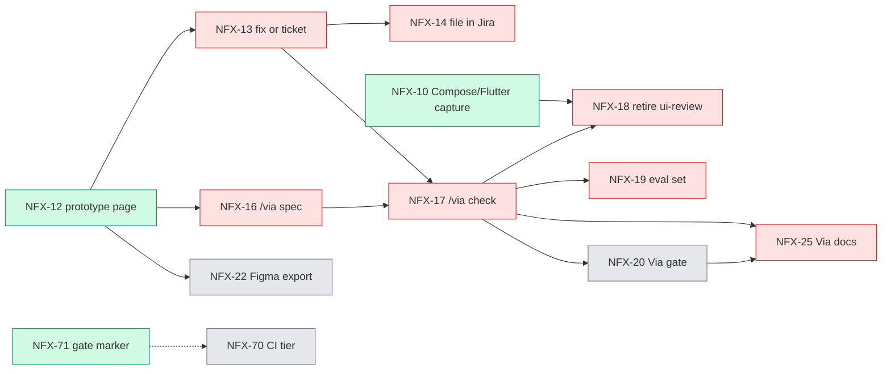

# NousFX roadmap

- Date: 2026-11-06 (after NFX-31, 32 and 51 merged)
- HEAD: `686c905` on `main` (clean tree, 0 open PRs)
- Source: Jira NFX, `statusCategory != Done` (32 tickets, counted from the 35 of the earlier run minus the three below) and Done in the last 14 days (41 tickets); `.claude/handoff.md`; `CHANGELOG.md`; `docs/RUNBOOK.md`
- Since last run: NFX-32 (#33), NFX-51 (#34, left out for good) and NFX-31 (#35) are Done. Open total went from 35 to 32 and v1.1 from 12 to 9. Counts are derived from the earlier Jira query, not re-queried.

## Answer

- v1.0: 1 ticket left. NFX-53 (live checks on Mac and Windows). It is yours.
- v1.1: 9 tickets, all Via. Critical path: NFX-12 → 13 / 16 → 17.
- Startable now: NFX-10, 12, 59.
- after-v1 label: 12 tickets, all parked.
- No version or label: 10 (4 epics, 2 specs, NFX-25, and NFX-69/70/71).

## Snapshot

| Group | Open | v1.0 | v1.1 | after-v1 | No label |
|---|---|---|---|---|---|
| M1 Via core (NFX-2) | 11 | 0 | 9 | 2 (11, 15) | 0 |
| M2 Via gate and exports (NFX-3) | 3 | 0 | 0 | 3 (20, 21, 22) | 0 |
| M3 Share-ready (NFX-4) | 1 | 0 | 0 | 0 | 1 (25) |
| M4 Portable harness (NFX-34) | 11 | 1 (53) | 0 | 7 | 3 (69, 70, 71) |
| Epics and specs (1, 2, 3, 4, 33, 34) | 6 | 0 | 0 | 0 | 6 |
| **Total** | **32** | **1** | **9** | **12** | **10** |

Check: 32 = 6 epics/specs + 11 + 3 + 1 + 11 children. Group membership of 69 to 71 (NFX-34) comes from the earlier fix notes, not re-read this run.

```
Done (14 d): about 41 tickets (earlier count plus the three merged today; not re-queried)
M1 Via core [█████████████░░░░░░░░░░░░░░░░░]  8 done / 11 open
M4 harness  [████████████████████░░░░░░░░░░]  22+ done / 11 open
M3 share    [██████████████████████░░░░░░░░]  3 done / 1 open
M2 gate     [░░░░░░░░░░░░░░░░░░░░░░░░░░░░░░]  0 done / 3 open
```

## Organization

```
NousFX (Jira NFX)
├─ NFX-1  Spec: Via
├─ NFX-33 Spec: Portable harness
├─ M1 Via core (NFX-2)           11 open
├─ M2 Gate and exports (NFX-3)    3 open
├─ M3 Share-ready (NFX-4)         1 open
└─ M4 Portable harness (NFX-34)  11 open (incl. NFX-69, 70, 71)
```

## Dependency flow



```
NFX-12 ─┬─> NFX-13 ─┬─> NFX-14
        │           └─> NFX-17 ─┬─> NFX-18 (also needs NFX-10)
        ├─> NFX-16 ───> NFX-17  ├─> NFX-19
        └─> NFX-22 (after-v1)   ├─> NFX-20 (after-v1) ─> NFX-25
                                └─> NFX-25
Free: NFX-10, 12, 59                   NFX-71 before NFX-70 (handoff order, no Jira link)
```

## Tickets by group

### M1 Via core (NFX-2)

| Key | Title | Version | Blocked by (open) |
|---|---|---|---|
| NFX-10 | Compose and Flutter capture | v1.1 | none |
| NFX-11 | SwiftUI capture | after-v1 | none |
| NFX-12 | Before/after prototype page | v1.1 | none |
| NFX-13 | Fix-now or ticket routes | v1.1 | 12 |
| NFX-14 | File findings as Jira tickets | v1.1 | 13 |
| NFX-15 | Learning loop | after-v1 | none |
| NFX-16 | /via spec | v1.1 | 12 |
| NFX-17 | /via check | v1.1 | 13, 16 |
| NFX-18 | Retire ui-review | v1.1 | 10, 17 |
| NFX-19 | Via eval set | v1.1 | 17 |
| NFX-59 | Via works in agy | v1.1 | none |

### M2 Via gate and exports (NFX-3)

| Key | Title | Version | Blocked by (open) |
|---|---|---|---|
| NFX-20 | Via gate (`fable-review`) | after-v1 | 17 |
| NFX-21 | Obsidian run note | after-v1 | none |
| NFX-22 | /via export figma (`ready-for-human`) | after-v1 | 12 |

### M3 Share-ready (NFX-4)

| Key | Title | Version | Blocked by (open) |
|---|---|---|---|
| NFX-25 | Via docs, CONTRIBUTING, fresh-user test | none | 17, 20 |

### M4 Portable harness (NFX-34)

| Key | Title | Version | Blocked by (open) |
|---|---|---|---|
| NFX-53 | First real sync and live checks (`ready-for-human`) | v1.0 | none |
| NFX-43 | agy and OpenCode agents, fresh-CLI fallback | after-v1 | none |
| NFX-45 | Lean profile, skill-description budget | after-v1 | none |
| NFX-49 | Cross-tool eval | after-v1 | none |
| NFX-50 | OpenCode capability spike (deferred) | after-v1 | none |
| NFX-60 | Harness evals | after-v1 | none |
| NFX-61 | First NousFX MCP server (`gate_status`) | after-v1 | none |
| NFX-67 | Second-opinion model role, one review log | after-v1 | none |
| NFX-69 | tier.py: detect ui changes under components/ | none | none |
| NFX-70 | CI recomputes the review tier (`fable-review`) | none | none (link to 71 missing) |
| NFX-71 | Review gate: do not inherit the last marker | none | none |

## Waves

| Wave | Tickets |
|---|---|
| Now | NFX-12, 10, 59 |
| Next | NFX-13, 16 |
| Later | NFX-17, then 14, 18, 19 |
| Yours | NFX-53 |
| After v1 | 11, 15, 20, 21, 22, 25, 43, 45, 49, 50, 60, 61, 67, 69, 70, 71 |

## Inconsistencies

| # | Kind | Finding | Evidence | Suggested fix |
|---|---|---|---|---|
| 1 | Fact | The handoff says "open total is now about 33"; Jira shows 35 | JQL `statusCategory != Done` | Refresh the handoff |
| 2 | Check | NFX-69, 70, 71 carry no `after-v1` label or fixVersion, though the earlier note calls them after-v1 | labels in Jira | Add `after-v1` (labels are replaced whole), or pull them into v1.1 if you want them sooner |
| 3 | Check | NFX-71 must come before NFX-70 (handoff) but no `Blocks` link records it | no links | Add the link |
| 4 | Check | Handoff says the `review-loop` live run on Mac is "not yet recorded in `docs/RUNBOOK.md`"; the Claude Code Mac live row (line 155) is filled in, but the `review-loop` end-to-end part is not clear | `docs/RUNBOOK.md:155` | Confirm when closing NFX-53 |
| 5 | Check | Specs NFX-1 and NFX-33 are still To Do though their work is built | status | Mark Done |
| 6 | Check | NFX-25 (M3) is blocked by NFX-20 (M2, after-v1), so M3 waits on M2 | NFX-25 `Blocks:in NFX-20` | Intended? If not, drop the link |
| 7 | Check | NFX-59 (Via in agy) depends on agy skills (NFX-42, Done) with no link | no links | Optional link |
| 8 | Check | NFX-64 text says the repo is private; `via.json` still allow-lists it | handoff "Open questions" | Your call |
| 9 | Fact | RUNBOOK rows for agy live, Windows (both tools) are "pending (NFX-53)"; CHANGELOG 1.0.0 is "unreleased" | `docs/RUNBOOK.md:157-159`, `CHANGELOG.md:3` | Update both when NFX-53 closes |

Epics with all children Done: none. Done tickets with an open blocker: none among the open tickets' links; Done tickets' own links were not re-queried this run (unverified, it was "none" in the first run).

## Suggested order

Scores are a 0 to 3 judgment per column, not a ticket count.

| Ticket | Unblocks | Value | Risk | Priority | Effort | Total |
|---|---|---|---|---|---|---|
| NFX-53 live checks (you) | 2 | 3 | 3 | 2 | S | 10 |
| NFX-12 prototype page | 3 | 3 | 1 | 2 | M | 9 |
| NFX-17 /via check (after 13, 16) | 3 | 3 | 1 | 2 | M | 9 |
| NFX-13 fix or ticket | 3 | 2 | 1 | 2 | M | 8 |
| NFX-16 /via spec | 2 | 3 | 1 | 2 | M | 8 |
| NFX-10 capture | 1 | 2 | 1 | 2 | M | 6 |

- NFX-53: closes v1.0 so you can release 1.0.0.
- NFX-12: root of the Via chain.
- NFX-13, 16: either order; both feed NFX-17.
- NFX-17: unblocks 18, 19, 20, 25.
- NFX-10: second blocker of NFX-18; can run in parallel.

**Defer:** all `after-v1` tickets, NFX-69/70/71 (harness hardening), and OpenCode (NFX-50).

## Needs you

- NFX-53: agy sign-in, hook load, Windows run, `/context` numbers, systemMessage on SessionStart.
- Mark the CI check as required; approve retiring `install.sh`.
- Decide on the 13 differing hand-copied skills and `styles`.
- Design choices for NFX-12 (grilling first).
- Jira fixes in the table above (labels, links, spec status): ask before each write.
- NFX-22 is `ready-for-human`, but it is after-v1.
