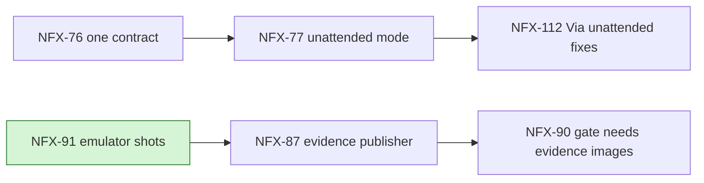

# NousFX roadmap

- Date: 2026-11-15 (v1.3.0 release PR NFX-151)
- HEAD: `d43f200` on `main` (NFX-151 is on branch `cesar/NFX-151`)
- Source: Jira NFX, `statusCategory != Done` (24 tickets, the query ran 2026-11-15); `.claude/handoff.md`; `CHANGELOG.md`
- Since last run (2026-11-13): the open count went from 25 to 24 (NFX-20, 25, 111 and 149 closed; new tickets include NFX-151). v1.3 "Via 2" is done. NFX-125 and NFX-141 moved to v1.4.

## Answer

- v1.3 "Via 2": every ticket is Done. The NFX-151 PR dates the CHANGELOG heading; the tag `v1.3.0` follows its merge, after Cesar says "tag it".
- Next release is v1.4 "Unattended mode and PR evidence": 10 open tickets. Start with NFX-91 (it unblocks NFX-87, which is High).

## Snapshot

| Group | Open | Top priority | Status |
| --- | --- | --- | --- |
| v1.3 Via 2 | 1 | Medium | NFX-151 (the release PR) |
| v1.4 Unattended mode and PR evidence | 10 | High (NFX-87) | NFX-76, 77, 87, 90, 91, 112, 125, 141, 146, 150 |
| Later | 8 | Medium | NFX-15, 21, 22, 43, 45, 50, 60, 67 |
| Epics (milestones) | 5 | Medium | NFX-2, 3, 4, 34, 84 |
| **Total** | **24** | | 5 epics + 19 tickets |

```
v1.1  [##########] shipped 2026-11-09
v1.2  [##########] shipped 2026-11-13
v1.3  [#########-] all tickets Done; NFX-151 dates the heading, then the tag
v1.4  [----------] not started
```

## Organization

```
Jira NFX
├── Epics: M1 Via core (2), M2 gate and exports (3), M3 share-ready (4), M4 portable harness (34), M5 unattended-ready (84)
└── Releases (fixVersion)
    ├── v1.3  ready to tag (NFX-151)
    ├── v1.4  76, 77, 87, 90, 91, 112, 125, 141, 146, 150
    └── Later 15, 21, 22, 43, 45, 50, 60, 67
```

## Dependency flow



```
NFX-76 -> NFX-77 -> NFX-112
NFX-91 -> NFX-87 -> NFX-90
```

NFX-111 (the other blocker of NFX-112) is Done.

## Per release

### v1.3

Every ticket is Done (NFX-20, 25, 111, 149, 81, 82, 124 and the rest). NFX-125 and NFX-141 moved to v1.4 on 2026-11-15. NFX-151 is the release PR.

### v1.4

| Key | Title | Priority | Status | Blocked by |
| --- | --- | --- | --- | --- |
| NFX-76 | One contract from any spec source | Medium | `ready-for-human`, size L | none |
| NFX-77 | Unattended mode: one definition, a draft PR without asking | Medium | `needs-triage`, size L | NFX-76 |
| NFX-87 | PR evidence publisher | High | `ready-for-agent`, size M | NFX-91 |
| NFX-90 | Gate requires evidence images on UI PRs | Medium | `ready-for-agent`, size S | NFX-87 |
| NFX-91 | Emulator shots: demo mode and crop | Medium | `ready-for-agent`, size M | none |
| NFX-112 | Via unattended: apply in-scope fix-now findings | Low | `ready-for-human`, size M | NFX-77 |
| NFX-125 | Live checks still unproven: Windows sync | Low | `ready-for-human`, env-device, size S | none (needs the Windows PC) |
| NFX-141 | ticket-check: can S tickets with explicit paths skip it? | Medium | `ready-for-agent`, size S | needs 5 future size-S tickets |
| NFX-146 | tier.py: try origin/master when origin/HEAD and origin/main are missing | Medium | `ready-for-agent`, size S | none |
| NFX-150 | Unattended review-loop files its follow-ups as needs-triage tickets | Medium | `needs-triage`, size M | none |

### Later

NFX-15 learning loop, 21 Obsidian run note, 22 `/via export figma` (device), 43 agy and OpenCode fallback, 45 lean profile, 50 OpenCode spike (human), 60 harness evals, 67 second-opinion role (`needs-triage`).

## Inconsistencies

| Kind | Evidence | Suggested fix |
| --- | --- | --- |
| Fact: stale doc | This file said `HEAD e9b41b1` and dated 2026-11-13. | Refreshed here. |
| Fact: flaky suite | The runbook's suites run on `origin/main` on 2026-11-15 gave 59/60 once and 60/60 on the rerun. The failing suite was not captured. | Rerun on CI; if it returns, find the suite and file a ticket. |
| Fact: runbook check | The runbook's one-liner prints `checks exit:` from the subshell, so piping the output into `tail` hides a failure. | Run it without a pipe, or read the "N/60 suites passed" line. |
| Check: epic state | NFX-2, 3 and 4 are open although v1.0 and v1.1 shipped. | Confirm which epics still have open children, then close the finished ones. |
| Check: unconfirmed live work | NFX-145 and NFX-147 rules are not yet proven in real CI. NFX-115 is not proven on Windows. | The next real PR with a skip label covers CI; NFX-125 covers Windows. |
| Order violations | Done tickets with an open blocker: none found. Epics with every child Done: not computed (no child list queried). | |

## Suggested order

| Ticket | Unblocks | Value | Risk | Priority | Effort | Total |
| --- | --- | --- | --- | --- | --- | --- |
| NFX-91 | 2 | 2 | 1 | 2 | M | 7 |
| NFX-87 | 1 | 3 | 0 | 3 | M | 7 |
| NFX-146 | 0 | 1 | 1 | 2 | S | 4 |
| NFX-76 | 2 | 3 | 0 | 2 | L | 7 (needs you) |
| NFX-125 | 0 | 2 | 2 | 1 | S | 5 (needs you; Windows) |

1. NFX-91: first in the evidence chain; check whether it needs an emulator.
2. NFX-87: High priority, right after NFX-91.
3. NFX-146: small and unblocked.
4. NFX-76: starts the unattended chain; it is `ready-for-human`.
5. NFX-125 whenever you are at the Windows PC.

**Defer:** NFX-77 and NFX-112 (wait for NFX-76), NFX-141 (needs 5 future tickets), NFX-150 (`needs-triage`), and every "Later" ticket.

## Needs you

- Merge the NFX-151 PR, then say "tag it": I tag `v1.3.0` and mark v1.3 released in Jira (`docs/RUNBOOK.md`, "Cut a release").
- NFX-125, Windows part: `python scripts\nousfx_sync.py --tools claude,agy --check` on the Windows PC, and the NFX-115 check there.
- NFX-76 is `ready-for-human`; NFX-77 and NFX-150 need triage.
- Run `nousfx_sync.py` (installed gate and `settings.json` drift).
